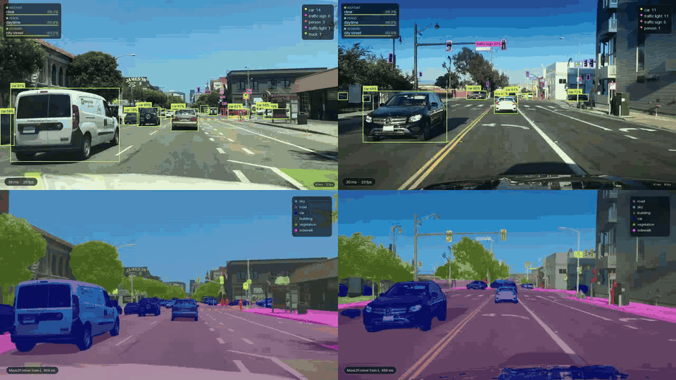

# BDD100K-Toolkit

[](https://github.com/dronefreak/bdd100k-toolkit/actions/workflows/ci.yml)
[](pyproject.toml)
[](https://pytorch.org/)
[](LICENSE)
[](https://github.com/dronefreak/bdd100k-toolkit/commits)
[](src/bdd100k_toolkit)
[](https://github.com/astral-sh/ruff)

<p align="center">
  
</p>

An unofficial, modern toolkit for the [BDD100K dataset](https://arxiv.org/abs/1805.04687). It prepares the data, trains and evaluates models with current libraries (PyTorch, Ultralytics, timm, Hydra), and renders demos on images and videos. The official [toolkit](https://github.com/bdd100k/bdd100k) and [model zoo](https://github.com/SysCV/bdd100k-models) are unmaintained and no longer install cleanly, so this project rebuilds the parts that matter, one task at a time, each checked on real data. The goal is a set of reproducible baselines for others to build on.

This repository currently supports the tasks listed below. For more information about each task, please click on the individual task's name.

| Task | Covers | Model zoo | Trainable architectures |
|---|---|---|---|
| [**Image Classification**](src/bdd100k_toolkit/classification) | weather, time of day and scenario (unofficial tasks) | 55 models | 1300+ in `timm`, 12+ in `ultralytics` |
| [**Object Detection**](src/bdd100k_toolkit/detection) | 10 classes | 10 models | 30+ in `ultralytics`, 5+ in `rfdetr` |
| [**Semantic Segmentation**](src/bdd100k_toolkit/segmentation) | 19 classes | in progress | |
| [**Object Tracking**](src/bdd100k_toolkit/tracking) | | planned | |

## Installation

The toolkit is not on PyPI yet, so install it from source (Python 3.10+):

```bash
git clone https://github.com/dronefreak/bdd100k-toolkit.git
cd bdd100k-toolkit
pip install -e ".[timm]"
```

Optional extras: `rfdetr` (RF-DETR detectors), `segmentation` (SMP training), `transformers` (pretrained
SegFormer and Mask2Former) and `dev` (tests and linters), e.g. `pip install -e ".[timm,rfdetr]"`.

## Quickstart

Download a detector and a weather classifier from the model zoo and run them on a dashcam frame (add
`--video clip.mp4` for a video, `--device cpu` without a GPU):

```bash
hf download dronefreak/bdd100k-yolo26s best.pt --local-dir weights/yolo26s
hf download dronefreak/bdd100k-weather-tiny_vit_21m_224 best.pt --local-dir weights/weather
python demo/detect.py --image frame.jpg --model weights/yolo26s/best.pt
python demo/classify.py --image frame.jpg --model weather=weights/weather/best.pt
```

To prepare the data, train and evaluate, every task uses the same three commands, `bdd100k-prepare`,
`bdd100k-train` and `bdd100k-evaluate`; the task pages above have the full recipes.

## Datasets

The official BDD100K website (bdd100k.com, bdd-data.berkeley.edu) is down. The original zips are still served, under the same license, by a Berkeley file server at <http://128.32.162.150/bdd100k/>, and the datasets below are unofficial redistributions on Hugging Face, which the BDD100K license allows as long as the copyright notice is carried forward.

To use this toolkit, download the datasets from Hugging Face (all with the original Berkeley labels):

| Task | Dataset |
|---|---|
| Object Detection | 🤗 [dronefreak/BDD100K](https://huggingface.co/datasets/dronefreak/BDD100K) |
| Weather Classification | 🤗 [dronefreak/BDD100K-Weather-Classification](https://huggingface.co/datasets/dronefreak/BDD100K-Weather-Classification) |
| Period Classification | 🤗 [dronefreak/BDD100K-Period-Classification](https://huggingface.co/datasets/dronefreak/BDD100K-Period-Classification) |
| Scenario Classification | 🤗 [dronefreak/BDD100K-Scenario-Classification](https://huggingface.co/datasets/dronefreak/BDD100K-Scenario-Classification) |
| Semantic Segmentation | 🤗 [dronefreak/BDD100K-Semantic-Segmentation](https://huggingface.co/datasets/dronefreak/BDD100K-Semantic-Segmentation) |

## Roadmap

- [x] Classification: weather, period, scenario (with image and video demos)
- [x] Object detection data pipeline and baselines
- [ ] Semantic segmentation
- [ ] Instance segmentation
- [ ] Panoptic segmentation
- [ ] Object tracking (MOT)
- [ ] ONNX/TensorRT export

## License

BSD-3-Clause for the code. BDD100K data, including the Hugging Face copy, stays under the [BDD100K License](https://github.com/bdd100k/bdd100k/blob/master/doc/source/license.rst): free for educational, research and not-for-profit use with the UC Regents copyright notice carried forward; commercial use needs separate permission.

## Citation

To cite the BDD100K dataset in your paper,

```latex
@InProceedings{bdd100k,
    author = {Yu, Fisher and Chen, Haofeng and Wang, Xin and Xian, Wenqi and Chen,
              Yingying and Liu, Fangchen and Madhavan, Vashisht and Darrell, Trevor},
    title = {BDD100K: A Diverse Driving Dataset for Heterogeneous Multitask Learning},
    booktitle = {IEEE/CVF Conference on Computer Vision and Pattern Recognition (CVPR)},
    month = {June},
    year = {2020}
}
```

## References

- [BDD100K toolkit](https://github.com/bdd100k/bdd100k): the original toolkit
- [BDD100K model zoo](https://github.com/SysCV/bdd100k-models): the original model zoo
- [timm](https://github.com/huggingface/pytorch-image-models): classification backend
- [Ultralytics](https://github.com/ultralytics/ultralytics): YOLO classification and detection backend
- [RF-DETR](https://github.com/roboflow/rf-detr): transformer detection backend
