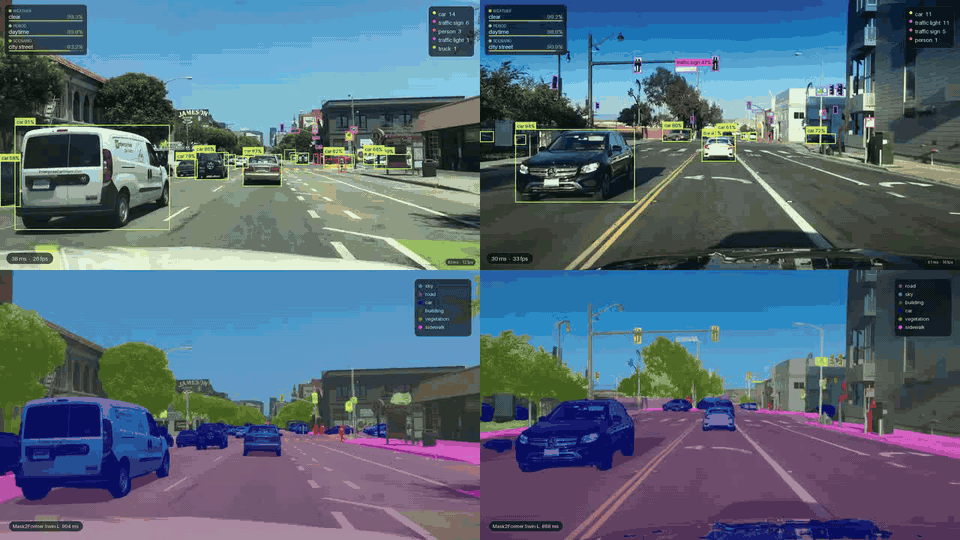

# Image Classification

Predict the per-image attributes of BDD100K: weather, time of day (period) and scenario.
These tasks are **unofficial**: BDD100K defines no classification benchmark, only
`attributes: {weather, timeofday, scene}` in its detection label JSON. The splits follow
three Kaggle datasets (`marquis03`, Apache-2.0), which are the same images and labels as
the official release, with `unknown` being the official `undefined`. The labels are the 2018
`attributes` of the official label JSON, read from the per-image files of
[dronefreak/BDD100K](https://huggingface.co/datasets/dronefreak/BDD100K)
(`data/labels/100k/{train,val,test}/`), the Berkeley zips or `bdd100k_labels_images_{train,val}.json`.



| Task | Classes | Source |
|---|---|---|
| Period (time of day) | 4: daytime, night, dawn or dusk, unknown | `attributes.timeofday` |
| Weather | 7: clear, partly cloudy, overcast, rainy, snowy, foggy, unknown | `attributes.weather` |
| Scenario | 7: city street, highway, residential, parking lot, gas stations, tunnel, unknown | `attributes.scene` |

## Model Zoo

55 models trained (20 weather, 20 period, 15 scenario), all on Hugging Face. Scores are on the official val set (the older prepared layout stored it as `test`, it is the
`valid` folder now; these models were trained on a seeded 85% of train); macro F1 is the main metric because the classes are heavily
imbalanced, and the best macro F1 of each task is in bold. Two backends: `ultralytics` (the `-cls` YOLO
models) and `timm` (everything else). Papers and citations: [CITATIONS.md](CITATIONS.md).

### Weather

| Model | Macro F1 | Top-1 | Balanced acc | Macro precision | Weights |
|---|---|---|---|---|---|
| **[TinyViT-21M, 2022](CITATIONS.md#tinyvit)** | **68.65%** | **83.90%** | **67.15%** | **74.81%** | 🤗 [**HuggingFace**](https://huggingface.co/dronefreak/bdd100k-weather-tiny_vit_21m_224) |
| [EfficientViT-B3, 2023](CITATIONS.md#efficientvit) | 68.17% | 83.51% | 66.34% | 81.75% | 🤗 [HuggingFace](https://huggingface.co/dronefreak/bdd100k-weather-efficientvit_b3) |
| [RepViT-M1.5, 2024](CITATIONS.md#repvit) | 67.78% | 83.19% | 65.71% | 81.56% | 🤗 [HuggingFace](https://huggingface.co/dronefreak/bdd100k-weather-repvit_m1_5) |
| [ConvNeXt-Atto, 2022](CITATIONS.md#convnext) | 67.44% | 83.00% | 65.25% | 81.38% | 🤗 [HuggingFace](https://huggingface.co/dronefreak/bdd100k-weather-convnext_atto) |
| [MobileNetV4-Conv-Large, 2024](CITATIONS.md#mobilenetv4) | 66.62% | 82.20% | 64.68% | 80.26% | 🤗 [HuggingFace](https://huggingface.co/dronefreak/bdd100k-weather-mobilenetv4_conv_large) |
| [MobileNetV4-Conv-Small, 2024](CITATIONS.md#mobilenetv4) | 66.51% | 82.16% | 64.37% | 80.44% | 🤗 [HuggingFace](https://huggingface.co/dronefreak/bdd100k-weather-mobilenetv4_conv_small) |
| [YOLOv8s-cls, 2023](CITATIONS.md#yolov8) | 66.34% | 81.40% | 63.52% | 71.54% | 🤗 [HuggingFace](https://huggingface.co/dronefreak/bdd100k-weather-yolov8s-cls) |
| [EfficientViT-B2, 2023](CITATIONS.md#efficientvit) | 66.07% | 83.46% | 65.04% | 67.54% | 🤗 [HuggingFace](https://huggingface.co/dronefreak/bdd100k-weather-efficientvit_b2) |
| [EfficientFormerV2-L, 2023](CITATIONS.md#efficientformerv2) | 65.93% | 83.27% | 65.03% | 67.12% | 🤗 [HuggingFace](https://huggingface.co/dronefreak/bdd100k-weather-efficientformerv2_l) |
| [EfficientViT-L1, 2023](CITATIONS.md#efficientvit) | 65.70% | 83.13% | 65.11% | 66.46% | 🤗 [HuggingFace](https://huggingface.co/dronefreak/bdd100k-weather-efficientvit_l1) |
| [EfficientFormerV2-S2, 2023](CITATIONS.md#efficientformerv2) | 65.50% | 82.90% | 64.68% | 66.98% | 🤗 [HuggingFace](https://huggingface.co/dronefreak/bdd100k-weather-efficientformerv2_s2) |
| [RepViT-M2.3, 2024](CITATIONS.md#repvit) | 65.46% | 83.02% | 64.33% | 67.02% | 🤗 [HuggingFace](https://huggingface.co/dronefreak/bdd100k-weather-repvit_m2_3) |
| [YOLO26s-cls, 2026](CITATIONS.md#yolo26) | 65.14% | 81.46% | 62.61% | 69.75% | 🤗 [HuggingFace](https://huggingface.co/dronefreak/bdd100k-weather-yolo26s-cls) |
| [EfficientViT-B0, 2023](CITATIONS.md#efficientvit) | 65.10% | 82.79% | 63.62% | 67.11% | 🤗 [HuggingFace](https://huggingface.co/dronefreak/bdd100k-weather-efficientvit_b0) |
| [EfficientViT-B1, 2023](CITATIONS.md#efficientvit) | 64.95% | 82.67% | 63.59% | 66.83% | 🤗 [HuggingFace](https://huggingface.co/dronefreak/bdd100k-weather-efficientvit_b1) |
| [ResNet-18, 2016](CITATIONS.md#resnet) | 64.30% | 82.19% | 62.97% | 66.08% | 🤗 [HuggingFace](https://huggingface.co/dronefreak/bdd100k-weather-resnet18) |
| [YOLO26n-cls, 2026](CITATIONS.md#yolo26) | 64.09% | 82.04% | 62.46% | 66.57% | 🤗 [HuggingFace](https://huggingface.co/dronefreak/bdd100k-weather-yolo26n-cls) |
| [YOLO11s-cls, 2024](CITATIONS.md#yolo11) | 63.81% | 81.91% | 62.05% | 66.35% | 🤗 [HuggingFace](https://huggingface.co/dronefreak/bdd100k-weather-yolo11s-cls) |
| [YOLOv8n-cls, 2023](CITATIONS.md#yolov8) | 63.07% | 81.22% | 61.42% | 65.52% | 🤗 [HuggingFace](https://huggingface.co/dronefreak/bdd100k-weather-yolov8n-cls) |
| [YOLO11n-cls, 2024](CITATIONS.md#yolo11) | 62.91% | 81.32% | 61.19% | 65.68% | 🤗 [HuggingFace](https://huggingface.co/dronefreak/bdd100k-weather-yolo11n-cls) |

### Period (time of day)

| Model | Macro F1 | Top-1 | Balanced acc | Macro precision | Weights |
|---|---|---|---|---|---|
| **[TinyViT-21M, 2022](CITATIONS.md#tinyvit)** | **83.19%** | **94.01%** | **79.63%** | **87.95%** | 🤗 [**HuggingFace**](https://huggingface.co/dronefreak/bdd100k-period-tiny_vit_21m_224) |
| [EfficientViT-L1, 2023](CITATIONS.md#efficientvit) | 82.68% | 93.98% | 78.45% | 88.75% | 🤗 [HuggingFace](https://huggingface.co/dronefreak/bdd100k-period-efficientvit_l1) |
| [EfficientViT-B1, 2023](CITATIONS.md#efficientvit) | 82.63% | 93.77% | 78.93% | 88.38% | 🤗 [HuggingFace](https://huggingface.co/dronefreak/bdd100k-period-efficientvit_b1) |
| [EfficientViT-B2, 2023](CITATIONS.md#efficientvit) | 82.53% | 93.92% | 78.88% | 87.49% | 🤗 [HuggingFace](https://huggingface.co/dronefreak/bdd100k-period-efficientvit_b2) |
| [RepViT-M2.3, 2024](CITATIONS.md#repvit) | 82.35% | 93.89% | 78.49% | 87.72% | 🤗 [HuggingFace](https://huggingface.co/dronefreak/bdd100k-period-repvit_m2_3) |
| [RepViT-M1.5, 2024](CITATIONS.md#repvit) | 81.97% | 93.33% | 78.35% | 86.95% | 🤗 [HuggingFace](https://huggingface.co/dronefreak/bdd100k-period-repvit_m1_5) |
| [EfficientFormerV2-L, 2023](CITATIONS.md#efficientformerv2) | 81.65% | 93.31% | 78.36% | 86.02% | 🤗 [HuggingFace](https://huggingface.co/dronefreak/bdd100k-period-efficientformerv2_l) |
| [YOLO11s-cls, 2024](CITATIONS.md#yolo11) | 81.22% | 93.73% | 77.49% | 86.42% | 🤗 [HuggingFace](https://huggingface.co/dronefreak/bdd100k-period-yolo11s-cls) |
| [EfficientViT-B3, 2023](CITATIONS.md#efficientvit) | 81.04% | 93.77% | 76.29% | 88.43% | 🤗 [HuggingFace](https://huggingface.co/dronefreak/bdd100k-period-efficientvit_b3) |
| [EfficientViT-B0, 2023](CITATIONS.md#efficientvit) | 80.98% | 93.71% | 77.14% | 86.44% | 🤗 [HuggingFace](https://huggingface.co/dronefreak/bdd100k-period-efficientvit_b0) |
| [YOLOv8n-cls, 2023](CITATIONS.md#yolov8) | 80.85% | 93.56% | 76.26% | 87.87% | 🤗 [HuggingFace](https://huggingface.co/dronefreak/bdd100k-period-yolov8n-cls) |
| [ConvNeXt-Atto, 2022](CITATIONS.md#convnext) | 80.75% | 93.95% | 76.82% | 86.39% | 🤗 [HuggingFace](https://huggingface.co/dronefreak/bdd100k-period-convnext_atto) |
| [ResNet-18, 2016](CITATIONS.md#resnet) | 80.50% | 93.32% | 76.72% | 85.87% | 🤗 [HuggingFace](https://huggingface.co/dronefreak/bdd100k-period-resnet18) |
| [YOLO26n-cls, 2026](CITATIONS.md#yolo26) | 80.41% | 93.61% | 77.72% | 83.88% | 🤗 [HuggingFace](https://huggingface.co/dronefreak/bdd100k-period-yolo26n-cls) |
| [EfficientFormerV2-S2, 2023](CITATIONS.md#efficientformerv2) | 80.38% | 93.01% | 76.79% | 85.35% | 🤗 [HuggingFace](https://huggingface.co/dronefreak/bdd100k-period-efficientformerv2_s2) |
| [MobileNetV4-Conv-Small, 2024](CITATIONS.md#mobilenetv4) | 80.22% | 93.57% | 76.22% | 86.06% | 🤗 [HuggingFace](https://huggingface.co/dronefreak/bdd100k-period-mobilenetv4_conv_small) |
| [MobileNetV4-Conv-Large, 2024](CITATIONS.md#mobilenetv4) | 80.21% | 93.46% | 74.88% | 89.57% | 🤗 [HuggingFace](https://huggingface.co/dronefreak/bdd100k-period-mobilenetv4_conv_large) |
| [YOLO11n-cls, 2024](CITATIONS.md#yolo11) | 80.13% | 93.79% | 75.19% | 88.20% | 🤗 [HuggingFace](https://huggingface.co/dronefreak/bdd100k-period-yolo11n-cls) |
| [YOLO26s-cls, 2026](CITATIONS.md#yolo26) | 80.10% | 93.36% | 75.74% | 86.84% | 🤗 [HuggingFace](https://huggingface.co/dronefreak/bdd100k-period-yolo26s-cls) |
| [YOLOv8s-cls, 2023](CITATIONS.md#yolov8) | 79.94% | 93.46% | 75.66% | 86.39% | 🤗 [HuggingFace](https://huggingface.co/dronefreak/bdd100k-period-yolov8s-cls) |

### Scenario

| Model | Macro F1 | Top-1 | Balanced acc | Macro precision | Weights |
|---|---|---|---|---|---|
| **[TinyViT-21M, 2022](CITATIONS.md#tinyvit)** | **62.52%** | **77.99%** | **66.21%** | **59.66%** | 🤗 [**HuggingFace**](https://huggingface.co/dronefreak/bdd100k-scenario-tiny_vit_21m_224) |
| [ConvNeXt-Atto, 2022](CITATIONS.md#convnext) | 61.06% | 77.44% | 60.34% | 67.92% | 🤗 [HuggingFace](https://huggingface.co/dronefreak/bdd100k-scenario-convnext_atto) |
| [EfficientViT-B3, 2023](CITATIONS.md#efficientvit) | 57.70% | 79.32% | 53.59% | 71.54% | 🤗 [HuggingFace](https://huggingface.co/dronefreak/bdd100k-scenario-efficientvit_b3) |
| [ConvNeXt-Tiny, 2022](CITATIONS.md#convnext) | 56.88% | 76.69% | 59.82% | 54.60% | 🤗 [HuggingFace](https://huggingface.co/dronefreak/bdd100k-scenario-convnext_tiny) |
| [EfficientViT-B1, 2023](CITATIONS.md#efficientvit) | 54.15% | 78.01% | 49.41% | 70.13% | 🤗 [HuggingFace](https://huggingface.co/dronefreak/bdd100k-scenario-efficientvit_b1) |
| [MobileNetV4-Conv-Small, 2024](CITATIONS.md#mobilenetv4) | 52.89% | 78.20% | 48.69% | 61.41% | 🤗 [HuggingFace](https://huggingface.co/dronefreak/bdd100k-scenario-mobilenetv4_conv_small) |
| [YOLO26s-cls, 2026](CITATIONS.md#yolo26) | 52.24% | 77.81% | 49.23% | 58.28% | 🤗 [HuggingFace](https://huggingface.co/dronefreak/bdd100k-scenario-yolo26s-cls) |
| [MobileNetV4-Conv-Large, 2024](CITATIONS.md#mobilenetv4) | 50.00% | 78.15% | 45.48% | 63.03% | 🤗 [HuggingFace](https://huggingface.co/dronefreak/bdd100k-scenario-mobilenetv4_conv_large) |
| [YOLO11n-cls, 2024](CITATIONS.md#yolo11) | 49.47% | 78.58% | 46.05% | 60.98% | 🤗 [HuggingFace](https://huggingface.co/dronefreak/bdd100k-scenario-yolo11n-cls) |
| [YOLO11s-cls, 2024](CITATIONS.md#yolo11) | 49.18% | 78.58% | 45.24% | 61.98% | 🤗 [HuggingFace](https://huggingface.co/dronefreak/bdd100k-scenario-yolo11s-cls) |
| [YOLOv8s-cls, 2023](CITATIONS.md#yolov8) | 48.43% | 77.15% | 46.64% | 51.16% | 🤗 [HuggingFace](https://huggingface.co/dronefreak/bdd100k-scenario-yolov8s-cls) |
| [YOLO26n-cls, 2026](CITATIONS.md#yolo26) | 48.33% | 76.78% | 43.94% | 58.99% | 🤗 [HuggingFace](https://huggingface.co/dronefreak/bdd100k-scenario-yolo26n-cls) |
| [ResNet-18, 2016](CITATIONS.md#resnet) | 47.29% | 77.14% | 44.83% | 54.25% | 🤗 [HuggingFace](https://huggingface.co/dronefreak/bdd100k-scenario-resnet18) |
| [YOLOv8n-cls, 2023](CITATIONS.md#yolov8) | 46.40% | 76.13% | 43.26% | 54.14% | 🤗 [HuggingFace](https://huggingface.co/dronefreak/bdd100k-scenario-yolov8n-cls) |
| [EfficientViT-B0, 2023](CITATIONS.md#efficientvit) | 46.10% | 75.94% | 42.64% | 53.74% | 🤗 [HuggingFace](https://huggingface.co/dronefreak/bdd100k-scenario-efficientvit_b0) |

All models are plain baseline runs (224 px input, the same recipe), except three scenario models, which use
a class-weighted loss: ConvNeXt-Atto at 512 px input, and ConvNeXt-Tiny and TinyViT-21M at 224 px.

## Download Data

The official BDD100K website is down (the original zips are still on a [Berkeley file server](http://128.32.162.150/bdd100k/)), and these are unofficial redistributions on Hugging Face (official
train, val and test images with their attribute labels; the test labels come from the same Berkeley label
package as train and val and are not independently verified). Download the dataset for the
task you need:

| Task | Dataset |
|---|---|
| Weather | 🤗 [dronefreak/BDD100K-Weather-Classification](https://huggingface.co/datasets/dronefreak/BDD100K-Weather-Classification) |
| Period | 🤗 [dronefreak/BDD100K-Period-Classification](https://huggingface.co/datasets/dronefreak/BDD100K-Period-Classification) |
| Scenario | 🤗 [dronefreak/BDD100K-Scenario-Classification](https://huggingface.co/datasets/dronefreak/BDD100K-Scenario-Classification) |

```bash
hf download dronefreak/BDD100K-Weather-Classification --repo-type dataset --local-dir /path/to/weather
```

`bdd100k-prepare` detects the layout itself, so the detection repo
[dronefreak/BDD100K](https://huggingface.co/datasets/dronefreak/BDD100K) (all three attributes
come from its label JSON), a copy of the official download (images plus label JSON) and the
Kaggle class folders work too. All three give the same `{train,valid,test}/<class>/*.jpg` output.

## Usage

```bash
bdd100k-prepare  --dataset bdd100k-weather --raw-dir /path/to/weather --output-dir /path/to/out
bdd100k-train    dataset=bdd100k-weather model.name=yolo11n-cls dataset.data_dir=/path/to/out
bdd100k-evaluate --dataset bdd100k-weather --checkpoint <run>/weights/best.pt --data-dir /path/to/out

# timm backend (pip install -e ".[timm]"), with class balancing
bdd100k-train dataset=bdd100k-weather model.backend=timm model.name=convnext_atto \
    +training.extra.balance=loss dataset.data_dir=/path/to/out

# demo on an image, a folder or a video
python demo/classify.py --image frame.jpg --model weather=<run>/weights/best.pt
```

The same commands work for `bdd100k-period` and `bdd100k-scenario`.
